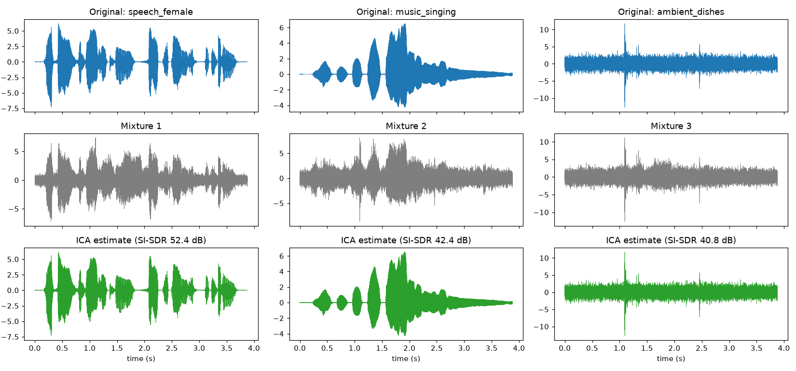
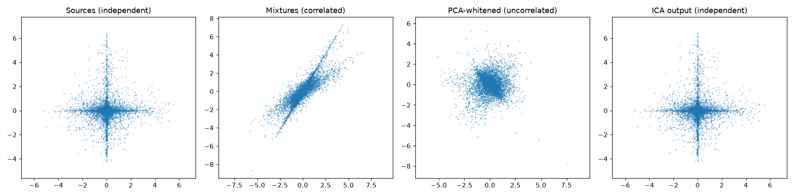

# 🎧 Unmix the Signal — ICA from scratch

Recover clean audio sources from mixed "microphone" recordings using **Independent Component
Analysis (FastICA) implemented from scratch in NumPy**. No `sklearn` / library ICA is used.

**Pipeline:** clean sources → mix with our own matrix → **center** → **PCA whitening**
(covariance + eigendecomposition) → **FastICA** (fixed-point, symmetric) → export `.wav` →
**evaluate** (|correlation| and SI-SDR, after solving scale + permutation ambiguity).

| | |
|---|---|
| Separation quality (3 sources) | **SI-SDR 41–52 dB, \|corr\| > 0.9999** for all sources |
| PCA alone (baseline) | SI-SDR −2.6 to 2.1 dB (not separated) |
| FastICA iterations | 5 |

Full numbers and all plots: **[RESULTS.md](RESULTS.md)**.

---

## 1. Audio sources

All clean sources are public recordings distributed with the open-source
[pyroomacoustics](https://github.com/LCAV/pyroomacoustics) project (MIT licence; speech from the
CMU ARCTIC corpus). Copies are in [`sources/`](sources/).

| File | Type | Original link |
|---|---|---|
| `speech_female.wav` | speech | [cmu_arctic_us_aew_a0001.wav](https://github.com/LCAV/pyroomacoustics/blob/master/examples/input_samples/cmu_arctic_us_aew_a0001.wav) |
| `speech_male.wav` | speech | [cmu_arctic_us_axb_a0004.wav](https://github.com/LCAV/pyroomacoustics/blob/master/examples/input_samples/cmu_arctic_us_axb_a0004.wav) |
| `music_singing.wav` | music (singing) | [singing_8000.wav](https://github.com/LCAV/pyroomacoustics/blob/master/examples/input_samples/singing_8000.wav) |
| `ambient_dishes.wav` | ambient (kitchen) | [doing_the_dishes.wav](https://github.com/LCAV/pyroomacoustics/blob/master/examples/input_samples/doing_the_dishes.wav) |

All signals are resampled to 16 kHz, trimmed to a common length and scaled to unit variance.

## 2. Separated audio (listen!)

In [`output/`](output/):

- `exp1_mixture_1..3.wav` — what each "microphone" hears (everything mixed together)
- `exp1_separated_speech_female.wav`, `exp1_separated_music_singing.wav`,
  `exp1_separated_ambient_dishes.wav` — what our ICA recovered
- `long_mixture_1..3.wav` and `long_separated_*.wav` — **30-second listening demo** (same sources looped; SI-SDR 52–55 dB)
- `exp2_*` (3 sources, 4 mics) and `exp3_*` (4 sources incl. two speakers, 4 mics)

## 3. How to run

```bash
pip install -r requirements.txt
python src/run_experiments.py
```

This regenerates `output/`, `plots/`, `results.json` and `RESULTS.md` (takes ~10 s).

## 4. Code

| File | What it does |
|---|---|
| [`src/ica.py`](src/ica.py) | `center`, `pca_whiten` (covariance + `eigh`), `fastica` (fixed-point + symmetric decorrelation), 3 non-linearities |
| [`src/metrics.py`](src/metrics.py) | \|corr\| matrix, Hungarian matching (permutation), SI-SDR (scale + sign), kurtosis |
| [`src/audio.py`](src/audio.py) | WAV load / resample / save (I/O only) |
| [`src/run_experiments.py`](src/run_experiments.py) | All experiments, plots and `RESULTS.md` |

`scipy` is used only for WAV I/O, resampling and the Hungarian assignment in evaluation —
never for whitening or ICA.

## 5. Experiments and why they were chosen

| # | Experiment | Question it answers |
|---|---|---|
| 1 | 3 sources → 3 mixtures (speech, music, ambient) | Does the basic method work on three very different signal types? |
| 2 | 3 sources → **4** mixtures | Requirement "at least N signals": what happens with an extra mic? PCA shows the 4th eigenvalue ≈ 0, so whitening reduces to 3 dimensions. |
| 3 | 4 sources incl. **two speakers** → 4 mixtures | Harder case: two signals of the same type. |
| 4 | Sensor-noise sweep (40 → 0 dB SNR, 5 seeds) | How robust is ICA when the mics add noise? |
| 5 | Non-linearity `logcosh` vs `exp` vs `cube` | Does the contrast function matter? |
| — | PCA vs ICA on every experiment | Proves *uncorrelated ≠ independent*. |

**Metrics.**
- **|Pearson correlation|** with the matched original: simple and intuitive, and ignores scale/sign.
- **SI-SDR** (scale-invariant signal-to-distortion ratio, in dB) — the standard metric in source
  separation. It finds the best scaling (including a negative one) of the reference before
  measuring the error, so it is immune to ICA's scale and sign ambiguity. +20 dB means the error
  energy is 1 % of the signal; 0 dB means error as large as the signal.
- **Permutation ambiguity:** ICA returns sources in random order, so each estimate is matched to
  an original by solving an assignment problem on the |correlation| matrix (Hungarian algorithm).

## 6. Results (summary)

- **ICA:** every source recovered with |corr| ≥ 0.9996 and SI-SDR 31–53 dB in all three
  experiments. Converges in 4–9 iterations.
- **PCA only:** SI-SDR between −4.7 and 4.5 dB, i.e. still mixed. Decorrelating is not enough.
- **Noise:** quality falls roughly 1 dB per dB of sensor noise (32 dB at 40 dB SNR, 3.5 dB at 10 dB SNR).
  Standard ICA assumes a noise-free model `x = As`, so noise is unmixed along with the sources.
- **Non-linearity:** `exp` (49.7 dB) ≥ `logcosh` (45.2 dB) > `cube` (35.2 dB). `cube` (kurtosis)
  is sensitive to the loud outliers in speech and the dish clatters.




---

## 7. Concepts ("be ready to explain")

### Why ICA and not PCA? (uncorrelated vs independent)
PCA only uses **second-order statistics** (the covariance). It finds directions that are
**uncorrelated**: `E[y1·y2] = 0`. But uncorrelated does not mean independent. Any rotation of
whitened data is still uncorrelated, so PCA cannot tell which rotation is the true one.

ICA asks for **statistical independence**: `p(y1, y2) = p(y1)·p(y2)`, which also involves
**higher-order statistics** (kurtosis, negentropy). That extra information picks out the single
correct rotation. In the scatter plot above, the whitened data is a round blob (uncorrelated,
but still mixed), and ICA rotates it back into the "+" shape of the original independent sources.
The PCA-vs-ICA bar chart shows the result: PCA ≈ 0 dB, ICA > 40 dB.

### What whitening does and why it simplifies ICA
Whitening transforms the centered data with `V = D^(-1/2) Eᵀ` (eigenvalues `D` and eigenvectors `E`
of the covariance) so the new signals are **uncorrelated with unit variance** (covariance = I).

After whitening, the remaining unmixing matrix must be **orthogonal (a pure rotation)**. An n×n
matrix has n² unknowns, but a rotation has only n(n−1)/2, so the problem shrinks (from 9 to 3
unknowns for 3 sources). It also lets FastICA keep the rows of W orthonormal with a simple
symmetric decorrelation step. With more mics than sources (experiment 2), whitening also reduces the
dimension by dropping eigenvalues that are ≈ 0.

### Why non-Gaussianity enables separation, and the Central Limit Theorem
The **Central Limit Theorem** says that a sum of independent random variables tends to be **more
Gaussian** than the individual variables. A mixture is a sum of sources, so **mixtures are more
Gaussian than sources** (measured here: speech kurtosis 3.9, singing 5.6, but mixture 1 is 2.4;
Gaussian noise is 0).

So ICA works backwards: find the projection `wᵀz` that is **as non-Gaussian as possible**, and
that projection must be one of the original sources. FastICA maximises an approximation of
**negentropy** using a non-linearity `G` (here `log cosh`), with the fixed-point update

```
w ← E[z·g(wᵀz)] − E[g′(wᵀz)]·w ,   then orthogonalise
```

This is also why ICA **cannot separate two Gaussian sources**: any rotation of a Gaussian blob
looks the same, so there is no direction to prefer. At most one source may be Gaussian.

### Ambiguities ICA cannot resolve (and how we handle them)
- **Scale/sign:** `x = A s = (A/c)(c s)`, so the amplitude and sign of each source are unknown.
  We normalise exported audio and use scale-invariant metrics.
- **Permutation:** the order of the outputs is arbitrary. We match with the Hungarian algorithm.

### How experiments and metrics were chosen
Different source types (speech / music / ambient) test whether separation is generic; the 4-mic
case tests the "≥ N mixtures" requirement and dimension reduction; two speakers test similar
sources; the noise sweep tests a realistic weakness; the non-linearity comparison tests a design
choice. SI-SDR is the field's standard metric and is scale-invariant by design, and |corr| is an easy
sanity check. Both are computed after permutation matching.

## 8. Limitations and next steps
- Mixing is **instantaneous and synthetic**. Real rooms create echoes and delays (convolutive
  mixing), which needs frequency-domain ICA. That's the main next step (real recordings from
  several phones).
- Plain ICA assumes no sensor noise, as experiment 4 shows.
- Stretch goal not attempted: mini-Shazam song identification.

## References
- A. Hyvärinen & E. Oja, *Independent Component Analysis: Algorithms and Applications*, Neural Networks, 2000.
- J. Le Roux et al., *SDR — half-baked or well done?*, ICASSP 2019 (SI-SDR).
