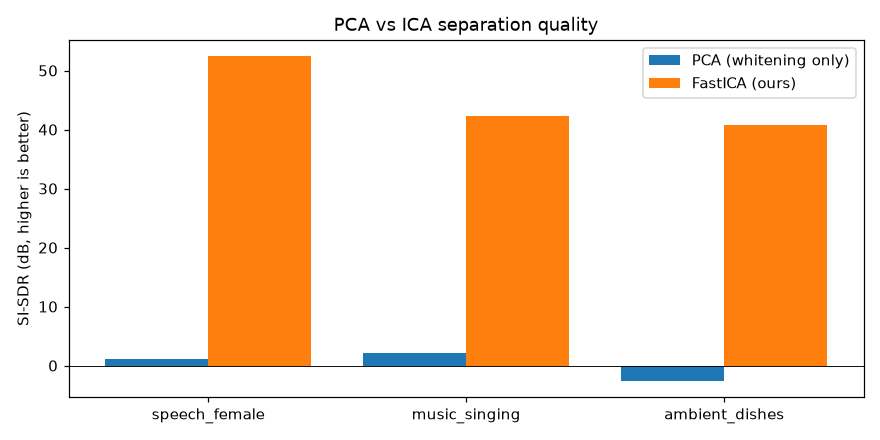
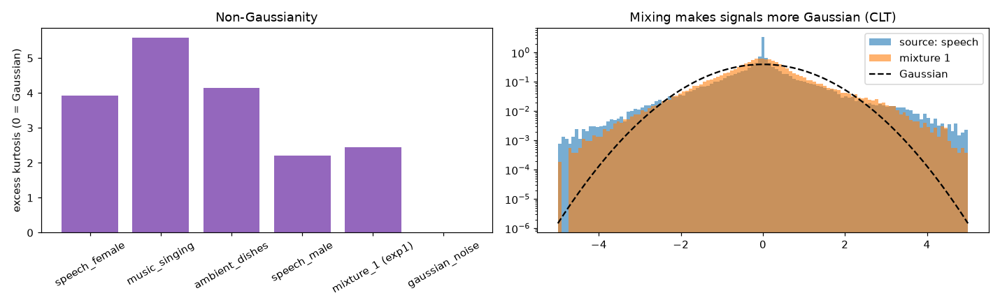
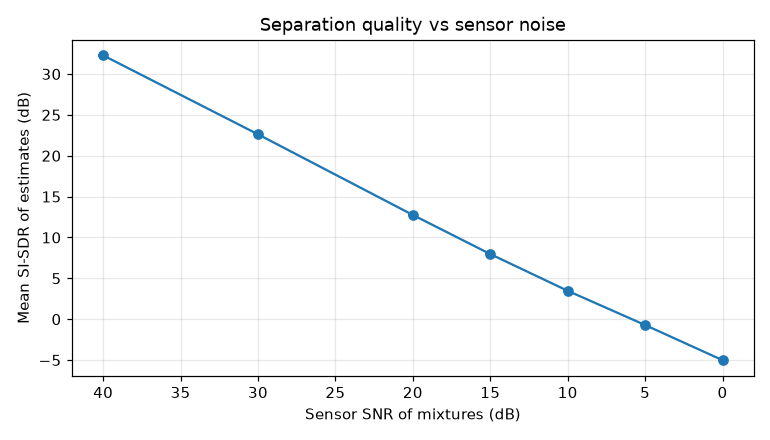
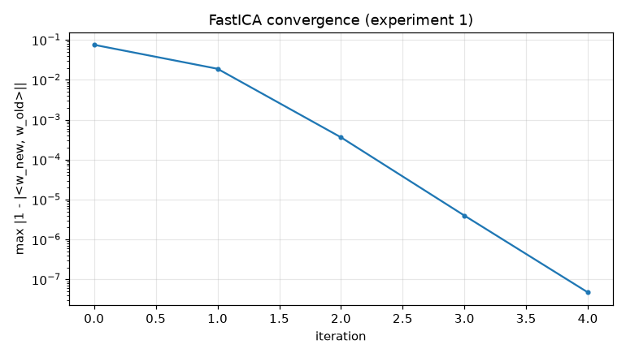

# Results

_Generated by `python src/run_experiments.py`._

## Experiment 1 — 3 sources → 3 mixtures

FastICA converged in **5** iterations.

| Source | ICA \|corr\| | ICA SI-SDR (dB) | PCA \|corr\| | PCA SI-SDR (dB) |
|---|---|---|---|---|
| speech_female | 1.0000 | 52.4 | 0.749 | 1.1 |
| music_singing | 1.0000 | 42.4 | 0.786 | 2.1 |
| ambient_dishes | 1.0000 | 40.8 | 0.596 | -2.6 |

## Experiment 2 — 3 sources → 4 mixtures (overdetermined)

FastICA converged in **4** iterations.

| Source | ICA \|corr\| | ICA SI-SDR (dB) | PCA \|corr\| | PCA SI-SDR (dB) |
|---|---|---|---|---|
| speech_female | 1.0000 | 53.1 | 0.768 | 1.6 |
| music_singing | 1.0000 | 42.4 | 0.858 | 4.5 |
| ambient_dishes | 1.0000 | 40.9 | 0.649 | -1.4 |

All 4 covariance eigenvalues: 5.31, 0.433, 0.377, -3.22e-15. With 4 microphones and only 3 sources the 4th eigenvalue is ~0 (no new information), so whitening keeps only the top 3 dimensions.

## Experiment 3 — 4 sources (two speakers) → 4 mixtures

FastICA converged in **9** iterations.

| Source | ICA \|corr\| | ICA SI-SDR (dB) | PCA \|corr\| | PCA SI-SDR (dB) |
|---|---|---|---|---|
| speech_female | 1.0000 | 41.7 | 0.645 | -1.5 |
| music_singing | 0.9999 | 38.0 | 0.611 | -2.2 |
| ambient_dishes | 0.9999 | 38.6 | 0.615 | -2.2 |
| speech_male | 0.9996 | 31.4 | 0.502 | -4.7 |

## Experiment 4 — sensor-noise sweep (mean over 5 seeds)

| Mixture SNR (dB) | Mean SI-SDR (dB) | Std |
|---|---|---|
| 40 | 32.3 | 0.02 |
| 30 | 22.6 | 0.02 |
| 20 | 12.8 | 0.01 |
| 15 | 8.0 | 0.01 |
| 10 | 3.5 | 0.02 |
| 5 | -0.7 | 0.04 |
| 0 | -5.0 | 0.03 |

## Experiment 5 — non-linearity G

| G | Mean SI-SDR (dB) | Iterations |
|---|---|---|
| logcosh | 45.2 | 5 |
| exp | 49.7 | 5 |
| cube | 35.2 | 5 |

## Excess kurtosis (0 = Gaussian)

| Signal | Kurtosis |
|---|---|
| speech_female | 3.92 |
| music_singing | 5.59 |
| ambient_dishes | 4.14 |
| speech_male | 2.20 |
| mixture_1 (exp1) | 2.44 |
| gaussian_noise | 0.02 |

## Plots

